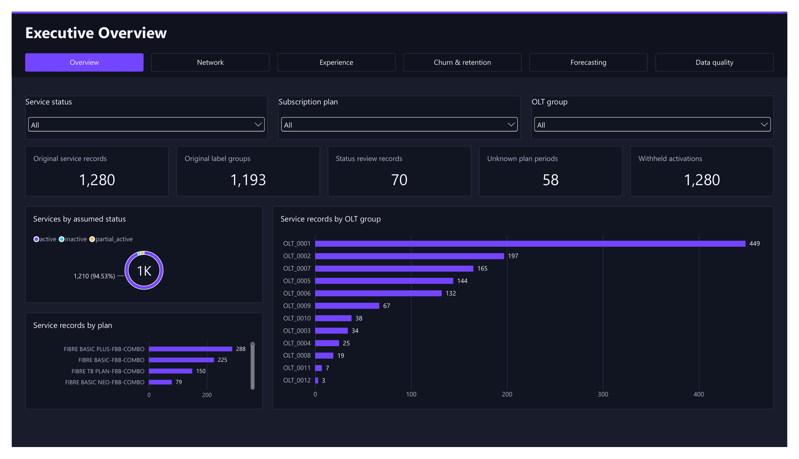
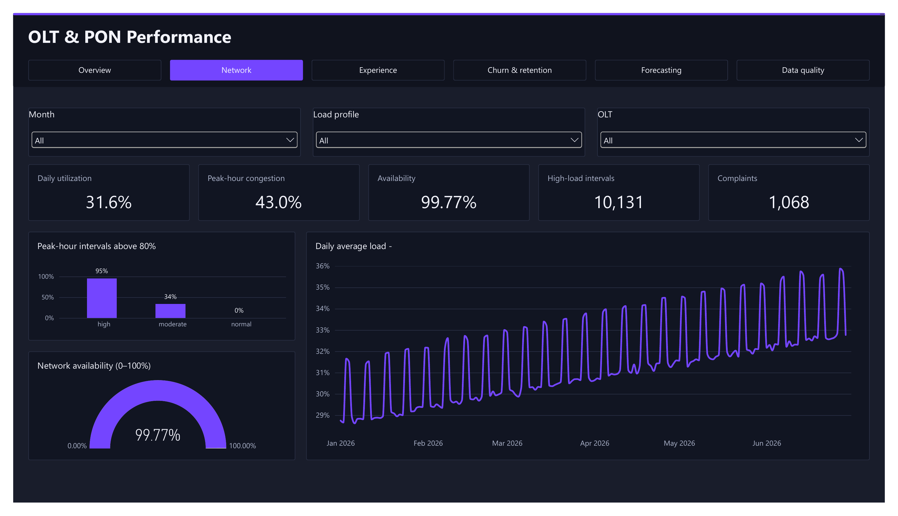
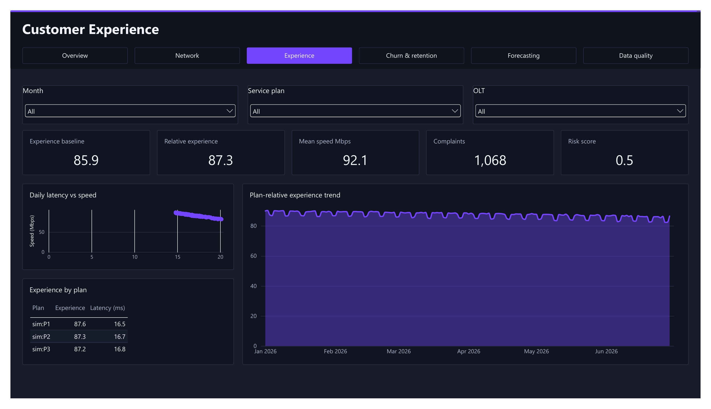
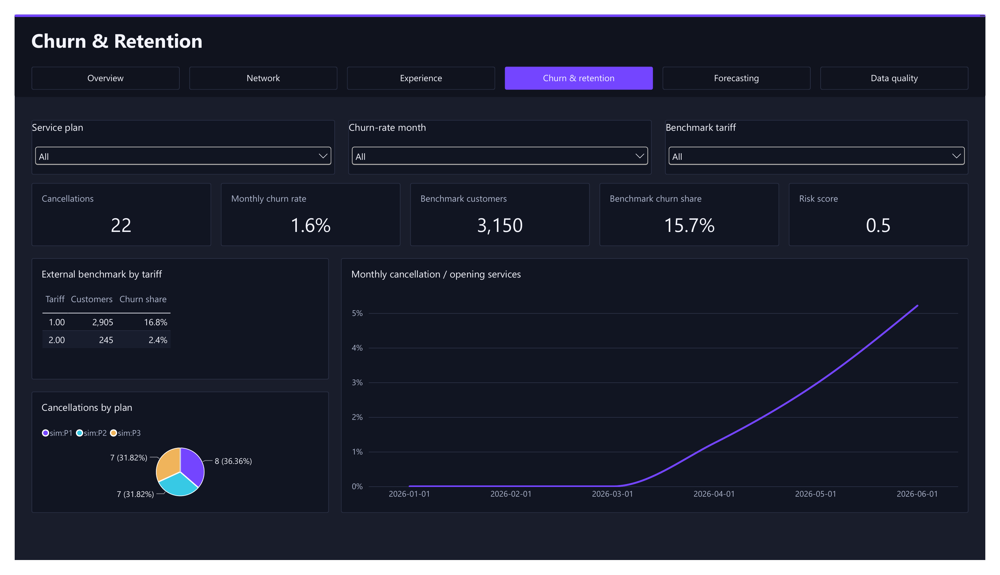
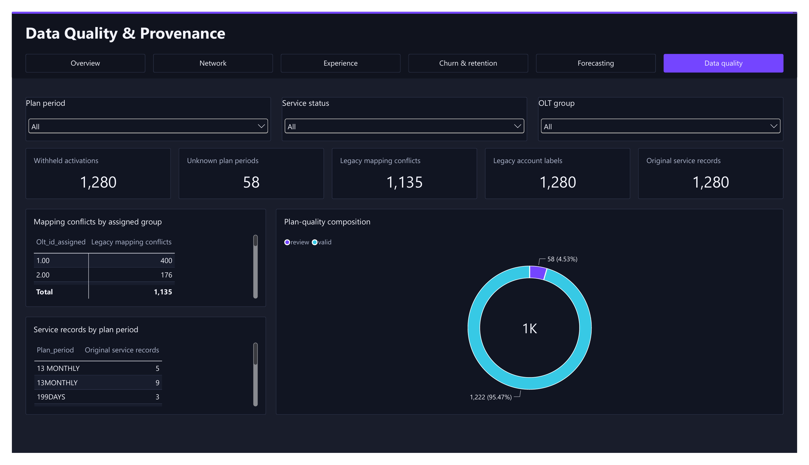

# Father's ISP FTTH / OLT Analytics

A Power BI portfolio project for reviewing broadband service records, network load, customer experience and data quality. Python and SQL support the data preparation and reconciliation; scenario-based pages demonstrate analysis where operational history is unavailable.

## Problem and analytical questions

Which services need review, how do plans and OLT groups differ, and which data gaps prevent reliable operational conclusions? The service snapshot supports status and plan analysis; simulated history and an external benchmark support separate demonstrations of network and churn analysis.

## Key findings

| Finding | Meaning |
|---|---|
| 1,280 service records; 1,193 normalized label groups | Records and grouped labels have different grains; groups are not verified unique people. |
| 1,210 active services (94.53%); 41 partial-active; 29 inactive | The assumed status mapping identifies 70 records for review. Inactivity is not historical churn. |
| 58 records with unspecified plan periods | Listed fees cannot all be treated as monthly recurring revenue. |
| 1,280 exact activation dates withheld | Public analysis does not infer original tenure or activation cohorts. |
| 12 source-address groups | These are not a verified inventory of physical OLT devices. |

The current report displays 31.6% daily utilization, 43.0% peak-hour congestion, 99.77% availability, 1,068 complaints and 22 cancellations **within its generated scenario**. Its 3,150-customer churn benchmark is a separate population. These figures do not establish actual ISP congestion, churn prediction accuracy or realized business improvements.

Monthly active/partial listed fee exposure is 2,956,272 undisclosed units across monthly plans. It is neither recognized revenue nor verified MRR. Earlier source reconciliation found 1,275 changed prepared activation dates and 810 dates beyond the assumed reference date; historical flags are retained. See the [plan-period and source documentation](docs/source_workbook_review.md).

## Dashboard preview

Six report pages explore service status, network performance, customer experience and data quality.

### Executive Overview



### OLT & PON Performance



### Customer Experience



### Churn & Retention



### Network Forecasting


### Data Quality & Provenance



## Report questions and data sources

| Report page | Analytical purpose | Data scope |
|---|---|---|
| Executive Overview | Review service status, subscription plans and OLT groups | Sanitized service snapshot |
| OLT & PON Performance | Explore utilization, high-load intervals and availability | Generated 180-day network scenario |
| Customer Experience | Compare speed, latency, complaints and experience scores | Generated scenario; analyst-defined scores |
| Churn & Retention | Examine cancellations and compare an external churn benchmark | Scenario lifecycles and a separate benchmark population |
| Network Forecasting | Compare actual scenario demand with model predictions | Scenario-based forecasting |
| Data Quality & Provenance | Inspect withheld dates, unknown plan periods and mapping conflicts | Snapshot and source-compatibility checks |

## How the analysis was built

- Organized public service inputs into a six-table star schema with explicit fact and dimension keys.
- Built Python and SQL checks for join integrity, record grain, status counts and plan-period denominators.
- Kept unreliable prepared activation dates out of tenure analysis and withheld exact source activation dates from public tables.
- Developed report views and DAX measures, with dated reconciliation receipts for the versioned service model.
- Extended the local report with network, experience, cancellation and forecasting demonstrations while keeping simulated results separate from snapshot observations.

## Challenges and lessons

| Challenge | Approach and lesson |
|---|---|
| Service rows and customer labels have different grains | Keep service counts separate from normalized label groups; neither is a verified count of people. |
| Activation dates and plan periods are unreliable or sensitive | Withhold exact dates and retain unknown plan periods rather than invent tenure or monthly revenue. |
| Operational network history is unavailable | Separate simulated metrics and external benchmarks from snapshot findings. |

## Data and project structure

The public pipeline begins with sanitized, frozen inputs derived from an author-supplied confidential service extract. It does not reproduce the private extraction. Status mappings and the reference date of 12 September 2026 are analytical assumptions. Sequential identifiers cannot safely join independently generated future extracts.

| Location | What is available |
|---|---|
| `assets/` | Current six-page dashboard gallery |
| `data/powerbi_star_schema/` | Public service-snapshot model tables |
| `scripts/` | Audits, model preparation, Power BI configuration and validation helpers |
| `tests/` | Data contracts, key integrity, source-date handling and report-input checks |
| `dashboard/OLT_Service_Project/` | Editable service-status Power BI project |
| `docs/` | Definitions, reproducibility instructions and dated evidence |

**Delivery scope:** the six-page report shown above is a local portfolio deliverable. The repository's editable Power BI source and commands below reproduce the service-status model. The newer report's PBIX, scenario pipeline and external inputs are not included in this public checkout.

## Run and validate

From the repository root, install the requirements in a virtual environment:

```bash
python -m pip install -r requirements.txt
python -m unittest discover -s tests -v
python scripts/audit_public.py
python scripts/analyze_public.py
python scripts/analyze_plan_periods.py
python scripts/build_dax_validation.py
python scripts/configure_powerbi.py
```

Open the included PBIP in Power BI Desktop, refresh its public CSV inputs, and run `docs/validate_measures.dax`. The documented service-model expectation is 114 checks across six filter contexts. [Desktop instructions and historical evidence](docs/powerbi_validation.md) · [Native MySQL instructions](docs/sql_engine_notes.md).

The source snapshot reviewed on 25 November 2026 passed **15 Python tests**. Historical receipts record **114 DAX checks** and **seven native MySQL 8.0.46 checks** for the service model; those engines were not rerun for this README edit. Portable SQLite checks are separate from native MySQL validation.

## Limitations and source protection

No stable operational customer/device mapping, measured longitudinal network history, verified churn outcomes or billing collections is available. Experience/risk scores and simulated cancellations do not imply validated probabilities or causal impact. Exact dates, contact details and raw OLT addresses must remain private; older Git history may retain legacy artifacts and has separate disclosure-review requirements.

Read the [data dictionary](docs/data_dictionary.md), [model](data/powerbi_star_schema/relationships_and_model.md), [methodology](docs/methodology.md), [date policy](docs/date_publication_policy.md), [key contract](docs/source_and_key_contract.md) and [portfolio review](docs/portfolio_review.md) for detailed definitions and evidence.

## Author

[Aswin S](https://github.com/Ashwin76038)
